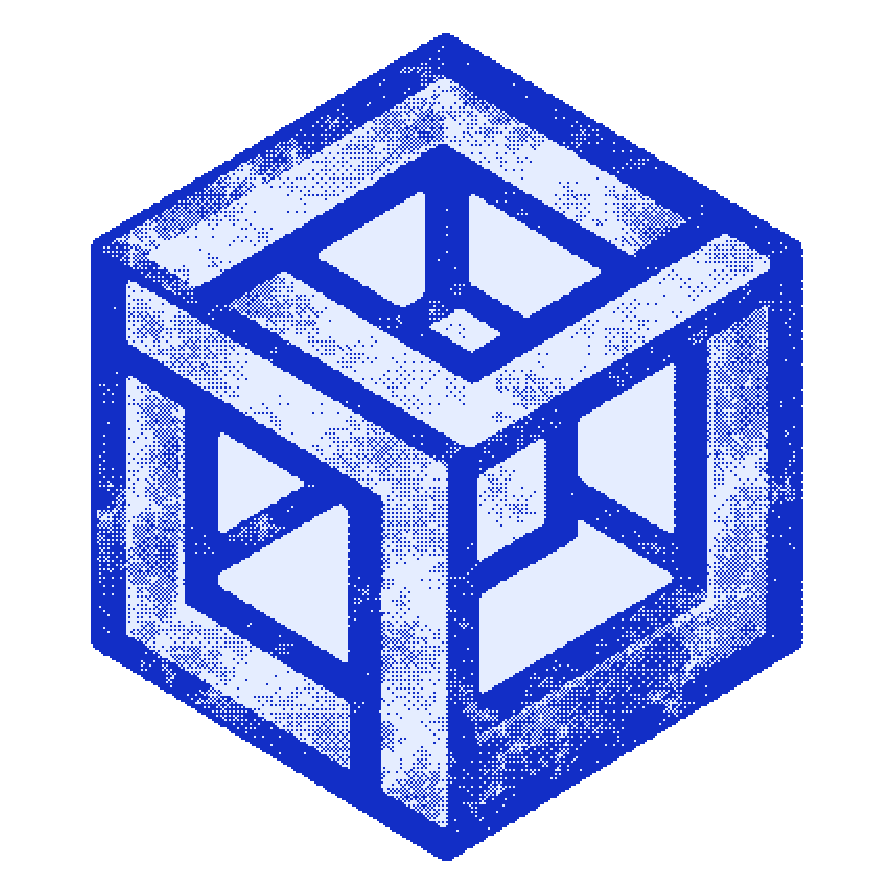
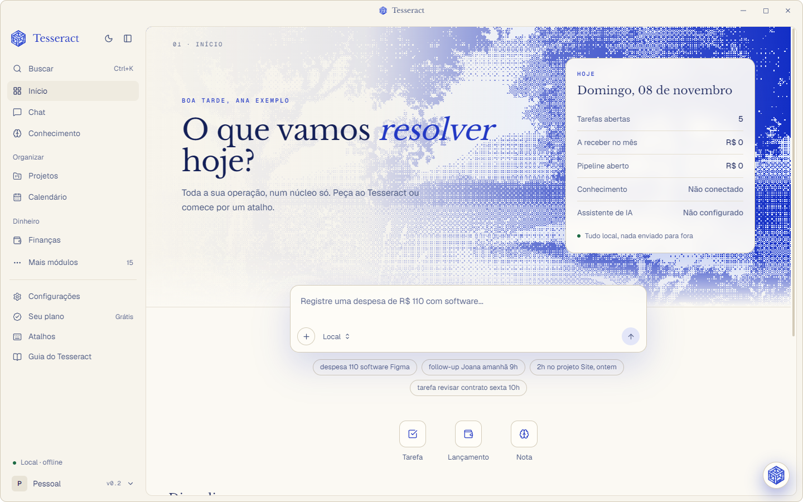
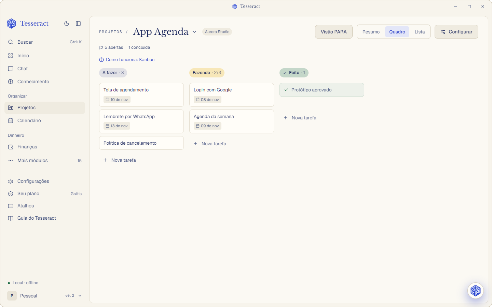
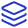
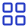
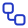

<a id="topo"></a>

<br />
<div align="center">
  <a href="https://tesseract.lanzilabs.dev">
    
  </a>

  <h1 align="center">Tesseract</h1>

  <p align="center">
    <b>Toda a sua operação, num núcleo só.</b>
    <br />
    Conhecimento, projetos, calendário e finanças num app de desktop para Windows: local, sem conta e sem internet.
    <br />
    <br />
    <a href="https://tesseract.lanzilabs.dev/download/"><b>Baixar</b></a>
    ·
    <a href="https://tesseract.lanzilabs.dev">Site</a>
    ·
    <a href="https://tesseract.lanzilabs.dev/guia/">Guia</a>
    ·
    <a href="https://github.com/enzGL/tesseract/issues/new?labels=bug">Reportar um erro</a>
    ·
    <a href="https://github.com/enzGL/tesseract/issues/new?labels=ideia">Sugerir uma ideia</a>
    ·
    <a href="https://tesseract.lanzilabs.dev/privacidade/">Privacidade</a>
  </p>

  <p align="center">
    <a href="./LICENSE"></a>
    <a href="https://github.com/enzGL/tesseract/stargazers"></a>
    <a href="https://github.com/enzGL/tesseract/issues"></a>
    
    
    
  </p>

  <p align="center">
    
    
    
    
    
    
    
  </p>
</div>

<p align="center">
  
</p>
<p align="center">
  
</p>

> [!IMPORTANT]
> O Tesseract está em **beta**. Este repositório é o **núcleo aberto**: compilado daqui, ele é o plano
> **Grátis** completo. Os módulos do **Pro** (CRM, documentos, horas, bots e os outros da tabela abaixo) ficam
> num repositório privado e vêm só no [instalador oficial](https://tesseract.lanzilabs.dev/download/), com a
> assinatura. Num build daqui, as telas do Pro aparecem no menu e explicam onde elas existem.

> [!TIP]
> Só quer usar? Não precisa compilar nada: baixe o instalador em
> [tesseract.lanzilabs.dev/download](https://tesseract.lanzilabs.dev/download/). O Grátis não pede cadastro.

##  O que é

O Tesseract junta num lugar só o que costuma ficar espalhado em cinco ferramentas: as suas notas, os seus
projetos, a sua agenda e o seu dinheiro. Tudo fica num banco **no seu computador**, funciona **sem internet** e
**sem conta**. A IA é uma camada de ajuda que só age com o seu ok; se ela estiver desligada, o resto continua
funcionando.

##  O que vem no Grátis

| | Recurso | O que faz |
|:-:|---|---|
|  | **Início do seu jeito** | Você escolhe o seu tipo de rotina e o app monta o menu e o painel. Widgets que se arrastam, módulos que se escondem, nomes que se trocam. |
|  | **Conhecimento** | Cria a sua base de notas em Markdown ou conecta uma que já existe (um vault do Obsidian, por exemplo), com busca por texto. |
|  | **Projetos** | Até 3 projetos ativos com **Kanban**, **Lista** e **Foco do dia**. |
|  | **Calendário** | A semana com prazos, tarefas agendadas e blocos de horário. |
|  | **Finanças pessoais** | Previsto, pago e recebido separados, com lançamentos manuais. |
|  | **Captura rápida** | `Ctrl+Shift+Espaço` de qualquer programa abre uma janelinha para anotar sem perder o foco. |
|  | **Trava do app** | Senha, código do app autenticador (TOTP) e Windows Hello. Trava junto com o Windows. |
|  | **Backup local** | Cópias automáticas do banco, com restaurar em um clique. |
|  | **Exportar tudo** | JSON, CSV, Markdown e agenda `.ics`, quando você quiser. Seus dados nunca ficam presos. |
|  | **Atalhos** | Busca com `Ctrl+K` e atalhos que você mesmo troca. |
|  | **Tutoriais** | Trilhas passo a passo por tipo de rotina, com guia dentro de cada tela. |

> [!NOTE]
> **Sempre grátis, por confiança:** backup, exportação total e leitura dos seus próprios dados. Um limite do
> plano nunca apaga nem esconde o que você já criou; ele só impede criar além dele.

##  O que o Pro acrescenta

O Pro é para quem usa o Tesseract para trabalhar e vender. Ele vem no instalador oficial, por assinatura, e o
código dele não está neste repositório.

| | Recurso | O que faz |
|:-:|---|---|
|  | **Sem limites** | Projetos ilimitados, todos os métodos (Eisenhower, GTD, Scrum, OKR, Shape Up…) e a linha do tempo do calendário. |
|  | **Organizações** | Cada empresa com os seus projetos, finanças e clientes separados. |
|  | **IA sobre as suas notas** | Busca por significado, chat com fonte em cada trecho e IA rodando no seu computador. |
|  | **Painel do negócio** | Receita por mês e por cliente, ticket médio, funil e o que cobrar. |
|  | **CRM e funil** | Empresas, contatos e oportunidades em 10 estágios, com follow-ups. |
|  | **Prospecção** | Empresas por nicho e cidade, com nota de 0 a 100 e critérios visíveis. |
|  | **Briefing** | Tudo sobre o cliente numa folha antes da reunião, com a fonte de cada item. |
|  | **Documentos** | Propostas, contratos e recibos em PDF com a sua marca, versões e parcelas. |
|  | **Modelos de negócio** | Projeto, proposta, contrato e parcelas montados de uma vez, por área. |
|  | **Horas** | Cronômetro por tarefa e cliente; as horas viram recibo ou proposta. |
|  | **Relatórios** | Status do projeto e extrato do mês para o cliente, em PDF ou página. |
|  | **Cobrança** | Parcelas da semana e atrasadas, com a mensagem de cobrança pronta. |
|  | **Finanças da empresa** | Importação de extrato OFX/CSV e conciliação. |
|  | **Campanhas** | Investimento, leads, CPL, CAC, ROAS e atribuição. |
|  | **Social** | Calendário editorial, rascunhos e aprovação. |
|  | **Bots** | Seis especialistas (Segurança, Jurídico, Marketing, Vendas, Finanças, Tecnologia); as recomendações viram tarefas. |
|  | **Automações** | Quando acontecer, se valer, então faça, com histórico e confirmação. |
|  | **Backup na nuvem** | Criptografado, na sua própria pasta do Drive, Dropbox ou OneDrive, com versões. |
|  | **Dois computadores** | A mesma base no notebook e no desktop, pela sua pasta de nuvem. |
|  | **Importar** | Notion, Trello e planilhas de finanças e contatos, com desfazer. |

Preços e planos: [tesseract.lanzilabs.dev/download](https://tesseract.lanzilabs.dev/download/#planos).

##  Privacidade

| | Promessa |
|:-:|---|
|  | Os seus dados ficam num banco **SQLite criptografado** no seu computador. |
|  | Funciona **sem internet e sem conta**. No Grátis, a única ida à internet é ver se há versão nova: um pedido do arquivo `latest.json`, sem nenhum dado seu. |
|  | **Sem telemetria.** Nada sai do computador sem você pedir. |
|  | A IA local roda pelo [Ollama](https://ollama.com). A IA externa é opcional, usa a sua chave e mostra o que vai sair antes de enviar. |
|  | Notas e documentos importados são tratados como **dados**, nunca como instruções para o app. |
|  | **Cláusula de continuidade:** se o projeto acabar, o código do Pro é liberado e o app continua funcionando offline. |

##  Compilar a partir do código

**Requisitos**

| | |
|:-:|---|
|  | Windows 10 ou 11, com WebView2 |
|  | [Node.js](https://nodejs.org) 22 ou mais novo |
|  | [Rust](https://rustup.rs) 1.90 ou mais novo, com o Visual Studio Build Tools (C++) |
|  | Opcional: [Ollama](https://ollama.com), para a IA no seu computador |

```bash
npm install
npm run tauri dev            # abre o app em modo de desenvolvimento
npm run teste                # abre com um banco de teste separado (.teste-dados/), sem tocar nos seus dados
npm run teste:limpo          # apaga o banco de teste e começa do zero
npm run typecheck            # confere os tipos do front
npm test                     # testes do front
cd src-tauri && cargo test   # testes do Rust
```

No navegador (`npm run dev`) o app abre sem banco, com um substituto em memória: serve para ver as telas, não
para usar.

> [!NOTE]
> Compilado daqui, o app é o **Grátis**, com os limites valendo. As telas do Pro aparecem no menu e mostram
> "Isso é do Tesseract Pro". O build oficial junta este núcleo com o repositório privado do Pro.

##  Estrutura

| | Pasta | O que tem |
|:-:|---|---|
|  | `src/` | Telas em React 19, TypeScript e Tailwind CSS 4 |
|  | `src/pages/` | Uma tela por módulo |
|  | `src/data/` | Tipos, chamadas ao Rust e regras de cada módulo |
|  | `src-tauri/src/` | Comandos em Rust (Tauri 2): banco, índice, IA, licença, trava e backup |
|  | `src-tauri/migrations/` | Migrações do SQLite, embutidas no binário |
|  | `installer/` | O instalador próprio, também em Tauri |
|  | `docs/tutoriais/` | As trilhas que aparecem na aba Tutorial |
|  | `src/pro-bridge.ts` | A ponte com o Pro: o que o build oficial encaixa no núcleo |

##  Contribuir

Erros e ideias são bem-vindos nas [issues](https://github.com/enzGL/tesseract/issues). Para mandar código,
abra uma issue antes, para combinarmos o caminho. Contribuições de código só entram com um termo de cessão
(CLA), que mantém possível licenciar o Pro.

##  Licença

O código é aberto para leitura (source-available) sob a [PolyForm Noncommercial 1.0.0](./LICENSE): você pode
ler, auditar, compilar e mudar para **uso não comercial**. Uso comercial precisa de uma assinatura do Tesseract.

O nome **Tesseract** e a logo não fazem parte da licença: cópias e versões modificadas não podem usá-los.

<div align="center">
  <br />
  Feito por <a href="https://lanzilabs.dev"><b>Lanzi Labs</b></a>
  <br />
  <sub><a href="#topo">voltar ao topo ↑</a></sub>
</div>
